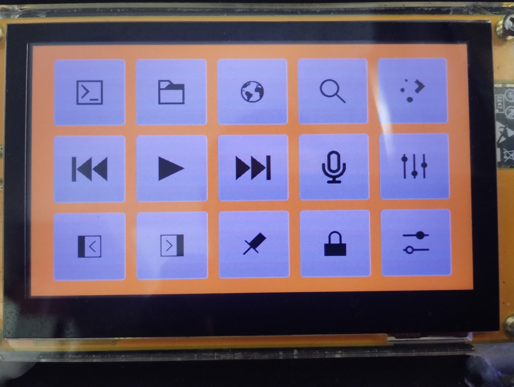
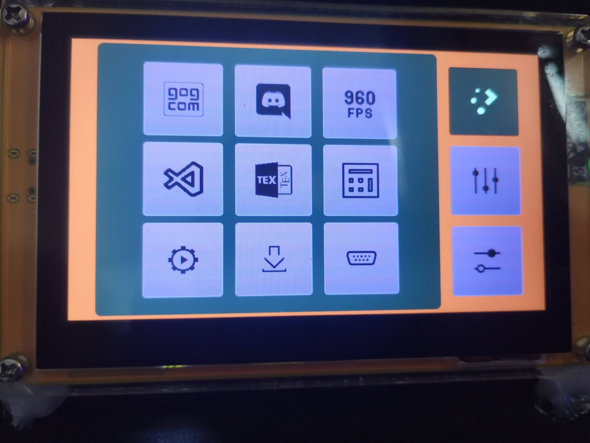
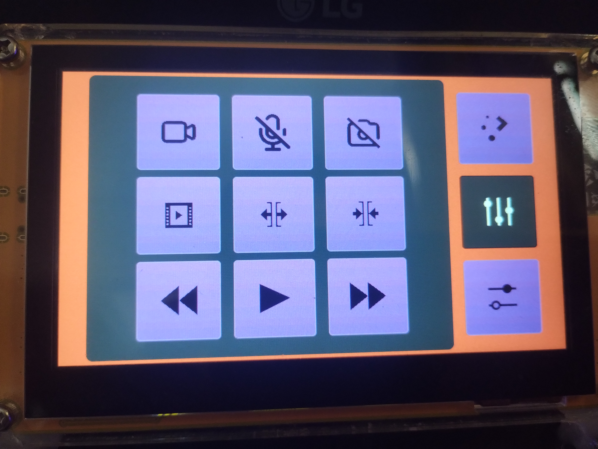
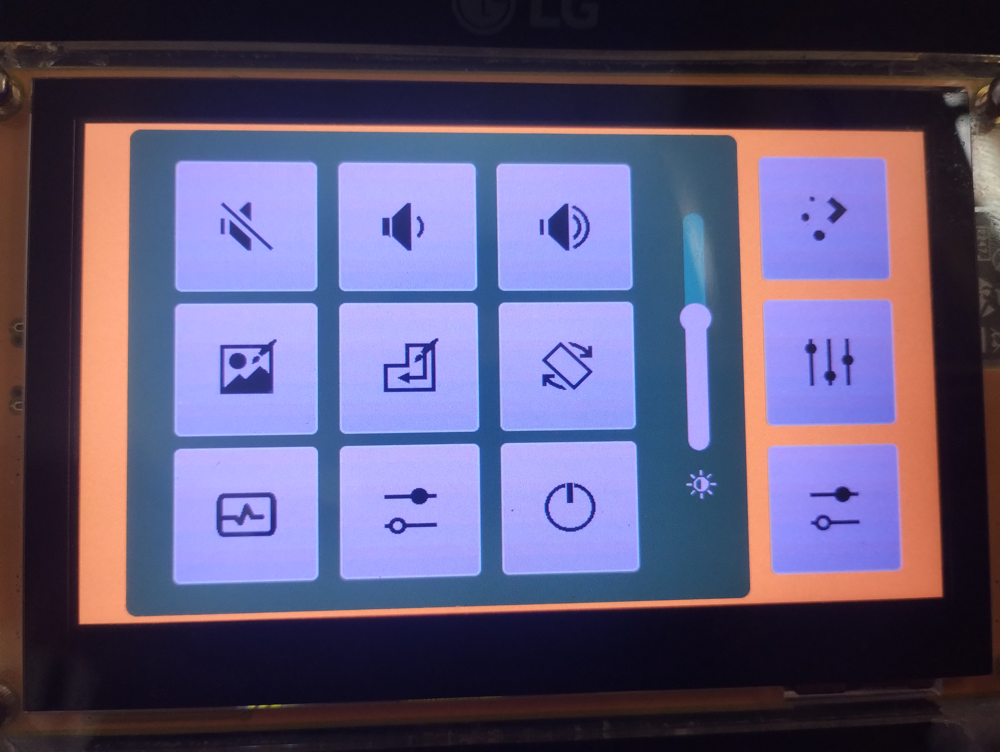
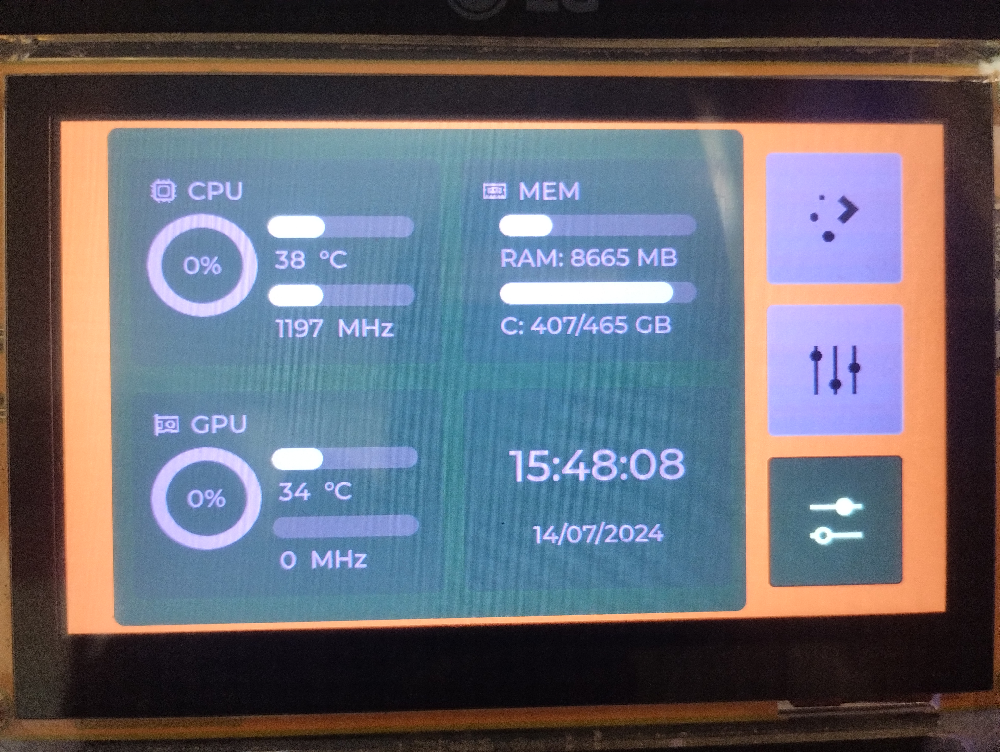

# StreamDeco
 ESP32 8048s43c board touch screen keypad connected at BLE Bluetooth to send keys shortcuts to computer.

 

 Board Specs:

    ESP32-S3 dual-core Xtensa 32-bit LX7 microprocessor, up to 240 MHz with 384KB ROM, 512KB SRAM. 2.4GHz WiFi and Bluetooth 5
    FLASH: 16MB
    PSRAM: 8MB
    Micro-SD card slot (SPI)
    4.3-inch 800x480 IPS TFT display - ST7262 (Parallel RGB-565 interface)
    Capacitive touch panel - GT911 (i2C - 0x5D or 0x14)
    1 USB-C to Serial 0 (CH340C)
    I2C / SPI / GPIOs

 Use Vscode and Platformio with Arduino Framework

  Librares

   LCD and Graphic:
       
   [LVGL v8.4.0](https://lvgl.io)
      
   [esp32_smartdisplay v2.0.9](https://github.com/rzeldent/esp32-smartdisplay)
       
   [platformio-espressif32-sunton](https://github.com/rzeldent/platformio-espressif32-sunton)

   Touch screen:
   
   [TAMC_GT911 v1.0.2](https://github.com/tamctec/gt911-arduino)

   Bluetooth and keyboard:
   
   [ESP32 BLE Keyboard v0.3.2](https://github.com/T-vK/ESP32-BLE-Keyboard)
   
   [NimBLE-Arduino v1.4.1](https://github.com/h2zero/NimBLE-Arduino)
   
   Others:
   
   [OpenHardwareMonitor](https://github.com/openhardwaremonitor/openhardwaremonitor)

   [LibreHardwareMonitor](https://github.com/LibreHardwareMonitor/LibreHardwareMonitor)

# Installation

## Python

Requirements: Windows, Python, the Python packages below, and a CH340 or CP210x USB-to-serial driver for the board. Download Python from the [official Windows downloads page](https://www.python.org/downloads/windows/) or install Python 3.14 with `winget install --id Python.Python.3.14 -e`.

The Python packages are hosted on the official [PyPI index](https://pypi.org/): [customtkinter](https://pypi.org/project/customtkinter/), [pystray](https://pypi.org/project/pystray/), [Pillow](https://pypi.org/project/pillow/), [pyserial](https://pypi.org/project/pyserial/), [psutil](https://pypi.org/project/psutil/), [pythonnet](https://pypi.org/project/pythonnet/), [GPUtil](https://pypi.org/project/GPUtil/), and [PyInstaller](https://pypi.org/project/pyinstaller/). Install them with `pip` as shown below so transitive dependencies are resolved automatically.

Install the packages and application from PowerShell at the repository root:

```powershell
py -m pip install --upgrade pip
py -m pip install customtkinter pystray pillow pyserial psutil pythonnet GPUtil pyinstaller
py .\StreamDecoMonitor\install_app.py
```

The installer builds the Windows executable, installs it under `%LOCALAPPDATA%`, creates a Start Menu shortcut, and registers a logon task with highest available privileges. Run PowerShell as an administrator to register the elevated task. The Python monitor needs administrative privileges to access hardware sensors; without them, some temperatures may be unavailable.

To run the Python preview from source instead, use `py .\StreamDecoMonitor\streamDeco_customtkinter_preview.py` after installing the same packages.

## .NET

Requirements to build the installer: Windows 10/11 x64, the .NET 10 SDK, Inno Setup 6, and internet access to restore NuGet packages. The app uses `LibreHardwareMonitorLib`, `System.IO.Ports`, and `System.Management`; NuGet restores these dependencies during publishing. A CH340 or CP210x USB-to-serial driver is needed to connect to the board.

Download the [.NET 10 SDK](https://dotnet.microsoft.com/download/dotnet/10.0) from Microsoft or install it with `winget install --id Microsoft.DotNet.SDK.10 -e`. Download [Inno Setup 6](https://jrsoftware.org/isdl.php) from its official site or install it with `winget install --id JRSoftware.InnoSetup -e`. The pinned NuGet dependencies are [LibreHardwareMonitorLib 0.9.4](https://www.nuget.org/packages/LibreHardwareMonitorLib/0.9.4), [System.IO.Ports 10.0.0](https://www.nuget.org/packages/System.IO.Ports/10.0.0), and [System.Management 10.0.0](https://www.nuget.org/packages/System.Management/10.0.0); `dotnet publish` restores them from NuGet automatically.

USB-to-serial drivers are available from the chip vendors: [CH340/CH341 for Windows (WCH)](https://www.wch-ic.com/downloads/CH341SER_EXE.html) and [CP210x VCP drivers (Silicon Labs)](https://www.silabs.com/developers/usb-to-uart-bridge-vcp-drivers). For command-line downloads, use the official Python or Microsoft download pages above; use `pip`, NuGet, and `winget` for packages rather than `wget`, so package metadata, dependencies, and installer hashes are handled correctly.

Build the self-contained installer from PowerShell at the repository root:

```powershell
.\StreamDecoMonitor.DotNet\Installer\build-installer.ps1
```

Run `artifacts\StreamDecoMonitor-Setup.exe` and approve the administrator prompt. The installer creates a Start Menu shortcut and offers optional desktop and Windows startup shortcuts. The app requests administrator privileges when opened so LibreHardwareMonitor can access protected sensors. The self-contained install does not require the .NET runtime on the target computer. The elevated startup task requires an administrator account.

### Windows Smart App Control

If Smart App Control blocks the installer, Windows does not provide a per-app exception or allowlist for this feature. Check its status under **Windows Security > App & browser control > Smart App Control**. In enforcement mode, apps must have a good reputation through Microsoft's app intelligence service or be signed with a certificate trusted by Windows. The locally built installer is not code-signed, so there is no **Run anyway** override for a Smart App Control block. Use a trusted, signed build or, on a managed device, ask the administrator to approve it through the organization's application-control policy. A Microsoft Defender Antivirus exclusion does not override Smart App Control.

Do not confuse this with a Microsoft Defender SmartScreen reputation warning. SmartScreen is separate; if its warning offers **More info > Run anyway**, use that only after verifying the installer came from a trusted source and checking its published hash when one is available. See Microsoft's [Smart App Control documentation](https://learn.microsoft.com/en-us/windows/apps/develop/smart-app-control/overview).

# How to USE

 Press Calendar (the former Ruler button) to open the current month. The arrows
 change months, and weeks start on Sunday. Today's highlight follows the selected
 background color. Touch outside the calendar, press Calendar again, or leave it
 inactive for 10 seconds to close it. Unpin other layers before opening Calendar.
 The date uses the existing clock synchronization with StreamDeco Monitor.

 Windows desktop monitor in C# / .NET (WPF), preserving the Python preview widgets and serial protocol: [StreamDeco Monitor .NET](StreamDecoMonitor.DotNet/README.md).

 Short click on Application button open Application layer, 
 after 10 seconds of inactivity the Application Layer is hidden 
 and user interface return to Main Layer
 
 Long click on Application button fixe the Application layer on screen,
 the fixed layer will not been hidden until a short click on Application Button.
 
 


 Short click on Multimedia button open Multimedia layer, 
 after 10 seconds of inactivity the Multimedia layer is hidden 
 and user interface return to Main layer.
 
 Long click on Multimedia button fixe the Multimedia layer on screen,
 the fixed layer will not been hidden until a short click on Multimedia Button.

 


 Short click on Configuration button open Configuration layer, 
 after 10 seconds of inactivity the Configuration layer is hidden 
 and user interface return to Main layer

 

 Slider on Configuration Layer change backlight bright, 
 the bright of backlight will be set to minimun after 30 seconds of inactivity.

 Long click on Configuration button open Monitor layer.

 

Working on Linux monitor version.

# Some buttons may work without configurations, but the most part need be configured on operational system.
 
Work on every system?
   NO, apparently MacOS and iOS have issues with bluettoth connection

Can I change icons?
   YES. In file streamDeco_objects.cpp the icons are linked to buttons.

Can I change command shortcuts?
   YES. In file streamDeco_shortcuts.cpp the shortcuts code are sended.

Additional terms of use:

    You can only use this project if you accept the name StreamDeco as the legitimate name of the product. It's not Stream Deck, it's not iDeck and it's not Google Deck. The name is StreamDeco!
